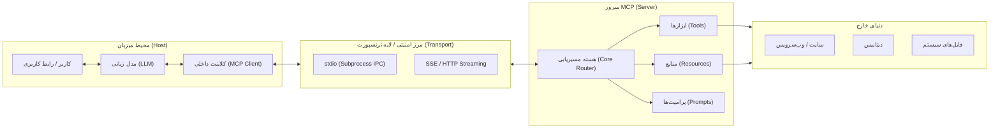

تا پیش از معرفی **پروتکل ارتباط مدل (Model Context Protocol یا به اختصار MCP)**، اتصال مدل‌های هوش مصنوعی (LLM) به ابزارها، دیتابیس‌ها و سرویس‌های بیرونی مانند وضعیت توسعه نرم‌افزار در دهه‌های گذشته بود؛ دورانی که هر پرینتر، اسکنر یا کارت گرافیک نیاز به درایور و کابل اختصاصی داشت.

اگر یک ابزار برای ادیتوری مثل VS Code یا کلاینتی مثل Cursor می‌نوشتید، در `Google Antigravity` یا `Claude Desktop` کار نمی‌کرد. پروتکل **MCP** با هدف پایان دادن به این پراکندگی، نقش یک **استاندارد باز جهانی (مشابه پورت USB-C برای هوش مصنوعی)** را بازی می‌کند.

در این مقاله، ابتدا به زبان دقیق مهندسی بررسی می‌کنیم که MCP در لایه زیرین شبکه و پردازش چطور کار می‌کند (پیام‌ها، هندشیک، ترنسپورت‌ها و قابلیت‌ها) و سپس **قدم‌به‌قدم یک سرور MCP واقعی و آماده پروداکشن با `TypeScript` برای وبلاگ `blog.mhkarami97.ir`** پیاده‌سازی می‌کنیم.

---

## ۱. مسئله اصلی: حل معضل پیچیدگی $M \times N$

فرض کنید $M$ محیط میزبانی هوش مصنوعی (مثل Antigravity، Claude Desktop، Cursor و محیط‌های اختصاصی سازمانی) و $N$ منبع داده (دیتابیس PostgreSQL، وبلاگ، مخزن گیت‌هاب، اسلک و فایل سیستم محلی) داریم:

* **بدون استاندارد مشترک:** توسعه‌دهندگان باید $M \times N$ آداپتور اختصاصی بنویسند و نگهداری کنند. هر تغییری در API یک سرویس، تمام کلاینت‌ها را دچار شکستگی می‌کرد.
* **با استفاده از MCP:** هر منبع داده فقط **یک‌بار** در قالب یک `MCP Server` پیاده‌سازی می‌شود و هر کلاینتی که از پروتکل MCP پشتیبانی کند، بلافاصله می‌تواند با تمام این سرورها گفتگو کند (پیچیدگی به $M + N$ کاهش می‌یابد).

این دقیقاً همان انقلابی است که مایکروسافت سال‌ها پیش با معرفی **Language Server Protocol (LSP)** در دنیای کامپایلرها و ادیتورهای کد به راه انداخت.

---

## ۲. آناتومی و معماری ۳ لایه پروتکل MCP

ارتباطات در دنیای MCP بر پایه یک معماری سه‌بخشی کلاینت-سرور با مرزبندی‌های امنیتی دقیق شکل می‌گیرد:



### ۱. میزبان (Host):
برنامه اصلی که کاربر با آن تعامل دارد (مثل `Google Antigravity` یا `Claude Desktop`). هاست مسئول مدیریت پنجره کانتکست مدل، اعمال سیاست‌های امنیتی، تایید دسترسی‌ها و کنترل فرآیندهای پس‌زمینه است.

### ۲. کلاینت (MCP Client):
ماژولی درون هاست که پروتکل را پیاده‌سازی می‌کند. کلاینت به ازای هر سرور متصل، یک ارتباط اختصاصی ۱ به ۱ برقرار می‌کند و درخواست‌های مدل را به پیام‌های استاندارد ترجمه می‌کند.

### ۳. سرور (MCP Server):
یک برنامه مستقل و سبک که ابزارها، منابع داده یا قالب‌های پرامپت را از طریق پروتکل اکسپوز می‌کند. سرور هیچ اطلاعی از اینکه چه مدلی (Gemini, Claude, GPT) در حال فراخوانی آن است ندارد؛ فقط ورودی استاندارد می‌گیرد و خروجی استاندارد تحویل می‌دهد.

---

## ۳. لایه‌های حمل‌ونقل (Transports): سرور چطور با هاست حرف می‌زند؟

پروتکل MCP در حال حاضر دو روش استاندارد برای انتقال داده‌ها تعریف کرده است:

### الف) لایه `stdio` (Standard Input / Standard Output)
* **نحوه کار:** هاست فرآیند سرور را به عنوان یک `subprocess` (زیرفرآیند محلی) اجرا می‌کند. تبادل پیام‌ها به صورت خط‌به‌خط (`Newline-delimited JSON-RPC`) از طریق پایپ‌های ورودی/خروجی استاندارد سیستم‌عامل (`stdin` و `stdout`) انجام می‌شود.
* **مزایا:** سرعت فوق‌العاده بالا، تاخیر نزدیک به صفر، بی‌نیازی از باز کردن پورت شبکه و سادگی احراز هویت.
* **خط قرمز حیاتی برای توسعه‌دهنده:** در سرورهای `stdio`، **هرگز نباید با `console.log` یا دستورات چاپ خروجی چیزی در ترمینال بنویسید!** زیرا خروجی استاندارد (`stdout`) منحصراً متعلق به تبادل پیام‌های JSON-RPC است و چاپ متن عادی، ساختار پروتکل را شکسته و کلاینت کرش می‌کند. تمام لاگ‌ها و پیام‌های خطایابی باید حتماً روی `stderr` (`console.error` در جاوااسکریپت یا `sys.stderr` در پایتون) فرستاده شوند.

### ب) لایه `SSE` (Server-Sent Events) روی HTTP
* **نحوه کار:** سرور روی یک پورت یا سرور ریموت اجرا می‌شود. کلاینت درخواست‌های خود را با `HTTP POST` می‌فرستد و پاسخ‌ها و اعلان‌های سرور را در یک استریم بلادرنگ `SSE` دریافت می‌کند.
* **مزایا:** مناسب برای استقرار سرورهای ریموت در داکر، کوبرنتیز یا شبکه‌های سازمانی برای استفاده همزمان چند کلاینت.

---

## ۴. زیر کاپوت پروتکل: کالبدشکافی پیام‌های خام JSON-RPC 2.0

تمام تبادلات در MCP بر اساس استاندارد **JSON-RPC 2.0** صورت می‌گیرد. بیایید ۳ تبادل اصلی را مستقیماً مرور کنیم:

### ۱. هندشیک آغازین (Initialize Handshake)
وقتی هاست سرور را اجرا می‌کند، ابتدا قابلیت‌های متقابل را استعلام می‌نماید:

**درخواست از کلاینت به سرور:**
```json
{
  "jsonrpc": "2.0",
  "id": 1,
  "method": "initialize",
  "params": {
    "protocolVersion": "2024-11-05",
    "capabilities": {
      "roots": { "listChanged": true },
      "sampling": {}
    },
    "clientInfo": {
      "name": "AntigravityHost",
      "version": "1.0.0"
    }
  }
}
```

**پاسخ سرور:**
```json
{
  "jsonrpc": "2.0",
  "id": 1,
  "result": {
    "protocolVersion": "2024-11-05",
    "capabilities": {
      "tools": { "listChanged": true },
      "resources": { "subscribe": false, "listChanged": false },
      "prompts": { "listChanged": false }
    },
    "serverInfo": {
      "name": "mhkarami-blog-mcp",
      "version": "1.0.0"
    }
  }
}
```

### ۲. استعلام لیست ابزارها (`tools/list`)
هاست از سرور می‌پرسد: «چه ابزارهایی با چه ورودی‌هایی در اختیار داری؟» و سرور لیست توابع را همراه با اسکیما برمی‌گرداند:

**پاسخ سرور (معرفی ابزار):**
```json
{
  "jsonrpc": "2.0",
  "id": 2,
  "result": {
    "tools": [
      {
        "name": "search_posts",
        "description": "جستجوی مقالات در وبلاگ بر اساس کلمه کلیدی یا تگ",
        "inputSchema": {
          "type": "object",
          "properties": {
            "query": { "type": "string", "description": "متن یا عنوان مورد جستجو" },
            "limit": { "type": "number", "description": "حداکثر تعداد نتایج" }
          },
          "required": ["query"]
        }
      }
    ]
  }
}
```

### ۳. فراخوانی ابزار (`tools/call`)
وقتی مدل زبانی حین تفکر تصمیم می‌گیرد این ابزار را صدا بزند:

**درخواست هاست:**
```json
{
  "jsonrpc": "2.0",
  "id": 3,
  "method": "tools/call",
  "params": {
    "name": "search_posts",
    "arguments": {
      "query": "EF Core",
      "limit": 1
    }
  }
}
```

**پاسخ سرور با داده واقعی:**
```json
{
  "jsonrpc": "2.0",
  "id": 3,
  "result": {
    "content": [
      {
        "type": "text",
        "text": "[{\"title\":\"چرا Rollback در EF Core تغییرات DbContext را برنمی‌گرداند؟\",\"url\":\"https://blog.mhkarami97.ir/posts/ef-core_rollback_change_tracker/\"}]"
      }
    ],
    "isError": false
  }
}
```

---

## ۵. سه ستون قابلیت‌های MCP: ابزارها، منابع و پرامپت‌ها

یک سرور MCP می‌تواند ۳ نوع موجودیت را در اختیار مدل قرار دهد:

| قابلیت | تعریف | تشبیه در وب | سناریوی استفاده |
| :--- | :--- | :--- | :--- |
| **Tools (ابزارها)** | توابع اجرایی و تعاملی دارای پارامتر | درخواست‌های `POST` | جستجو در API، اجرای کد، ویرایش دیتابیس |
| **Resources (منابع)** | داده‌های صرفاً خواندنی با URI اختصاصی | درخواست‌های `GET` | خواندن متن یک فایل، لاگ زنده، فید اخبار |
| **Prompts (پرامپت‌ها)** | الگوهای مهندسی‌شده با پارامترهای ورودی | فرم‌ها و قالب‌ها | قالب‌های آماده مثل «بررسی امنیتی این کد» |

---

## ۶. پیاده‌سازی گام‌به‌گام سرور MCP برای وبلاگ `blog.mhkarami97.ir`

اکنون به بخش عملیاتی کار می‌رسیم: می‌خواهیم برای وبلاگ شخصی `blog.mhkarami97.ir` یک سرور اختصاصی MCP با `TypeScript` بنویسیم.

### بررسی زیرساخت وبلاگ
وبلاگ ما از موتور `Jekyll` و قالب `Chirpy` استفاده می‌کند. یکی از قابلیت‌های عالی این قالب، تولید خودکار یک شاخص کامل از تمام مقالات در قالب فایل JSON به آدرس زیر است:
`https://blog.mhkarami97.ir/assets/js/data/search.json`

این فایل شامل عنوان (`title`)، آدرس پست (`url`)، دسته‌بندی‌ها (`categories`)، تگ‌ها (`tags`)، تاریخ (`date`) و محتوای متنی خلاصه مقاله (`content`) است. ما از همین اندپوینت زنده برای ساخت سرور خود استفاده می‌کنیم.

### قابلیت‌های سرور ما:
1. **ابزار `search_posts`:** جستجوی هوشمند در مقالات با واکشی ایندکس آنلاین وبلاگ.
2. **ابزار `get_latest_posts`:** دریافت آخرین مقالات به همراه متادیتا و تاریخ انتشار.
3. **ابزار `read_post`:** دریافت متن و محتوای یک مقاله برای مطالعه یا پاسخ‌دهی ایجنت به سوالات کاربر.
4. **منبع (Resource) `blog://feed`:** قرار دادن آخرین وضعیت فید مقالات در اختیار مدل به عنوان کانتکست پس‌زمینه.
5. **پرامپت (Prompt) `suggest_next_article`:** پرامپت آماده برای بررسی مقالات موجود و پیشنهاد موضوعات جدید برای نویسنده.

---

### گام اول: ساخت پروژه و نصب وابستگی‌ها

در ترمینال، یک دایرکتوری جدید بسازید و پروژه را مقداردهی اولیه کنید:

```bash
mkdir mhkarami-blog-mcp
cd mhkarami-blog-mcp
npm init -y
```

اکنون پکیج رسمی MCP، کتابخانه اعتبارسنجی `zod` و ابزارهای تایپ‌اسکریپت را نصب کنید:

```bash
npm install @modelcontextprotocol/sdk zod
npm install -D typescript @types/node
```

فایل `package.json` را باز کنید و فیلد `"type": "module"` و اسکریپت‌های بیلد را تنظیم کنید:

```json
{
  "name": "mhkarami-blog-mcp",
  "version": "1.0.0",
  "type": "module",
  "bin": {
    "mhkarami-blog-mcp": "./dist/index.js"
  },
  "scripts": {
    "build": "tsc",
    "start": "node dist/index.js"
  },
  "dependencies": {
    "@modelcontextprotocol/sdk": "^1.6.0",
    "zod": "^3.23.8"
  },
  "devDependencies": {
    "@types/node": "^22.0.0",
    "typescript": "^5.5.0"
  }
}
```

یک فایل پیکربندی تایپ‌اسکریپت به نام `tsconfig.json` در ریشه پروژه بسازید:

```json
{
  "compilerOptions": {
    "target": "ES2022",
    "module": "NodeNext",
    "moduleResolution": "NodeNext",
    "outDir": "./dist",
    "rootDir": "./src",
    "strict": true,
    "esModuleInterop": true,
    "skipLibCheck": true,
    "forceConsistentCasingInFileNames": true
  },
  "include": ["src/**/*"]
}
```

---

### گام دوم: نوشتن کدهای سرور (`src/index.ts`)

پوشه `src` را بسازید و فایل `src/index.ts` را ایجاد کنید:

```typescript
#!/usr/bin/env node

import { McpServer } from "@modelcontextprotocol/sdk/server/mcp.js";
import { StdioServerTransport } from "@modelcontextprotocol/sdk/server/stdio.js";
import { z } from "zod";

// ساختار مقالات در فایل search.json وبلاگ
interface BlogPost {
  title: string;
  url: string;
  categories: string;
  tags: string;
  date: string;
  content: string;
}

const BLOG_BASE_URL = "https://blog.mhkarami97.ir";
const SEARCH_INDEX_URL = `${BLOG_BASE_URL}/assets/js/data/search.json`;

// سیستم کش محلی (TTL Caching) برای بهینه‌سازی مصرف پهنای باند و سرعت پاسخ‌دهی
let cachedPosts: BlogPost[] | null = null;
let lastFetchTime = 0;
const CACHE_TTL_MS = 10 * 60 * 1000; // ۱۰ دقیقه

async function fetchBlogPosts(): Promise<BlogPost[]> {
  const now = Date.now();
  if (cachedPosts && now - lastFetchTime < CACHE_TTL_MS) {
    return cachedPosts;
  }

  try {
    const response = await fetch(SEARCH_INDEX_URL, {
      headers: {
        "User-Agent": "MHKarami-Blog-MCP-Server/1.0"
      }
    });

    if (!response.ok) {
      throw new Error(`HTTP error! status: ${response.status}`);
    }

    const data = (await response.json()) as BlogPost[];
    cachedPosts = data;
    lastFetchTime = now;
    return cachedPosts;
  } catch (error) {
    console.error("خطا در واکشی ایندکس مقالات وبلاگ:", error);
    if (cachedPosts) {
      return cachedPosts; // در صورت قطعی موقت، از کش قبلی استفاده می‌کنیم
    }
    throw error;
  }
}

// ساخت نمونه سرور با کلاس رسمی McpServer
const server = new McpServer({
  name: "mhkarami-blog-mcp",
  version: "1.0.0"
});

// -------------------------------------------------------------
// ۱. تعریف ابزارها (Tools)
// -------------------------------------------------------------

// ابزار جستجوی مقالات بر اساس کلمه کلیدی
server.tool(
  "search_posts",
  "جستجوی مقالات در وبلاگ تخصصی مهندسی نرم‌افزار محمدحسین کرمی بر اساس عنوان، متن، تگ یا دسته‌بندی",
  {
    query: z.string().describe("عبارت جستجو (مثلاً: EF Core, Antigravity, Transaction)"),
    limit: z.number().optional().default(5).describe("حداکثر تعداد نتایج برای بازگرداندن")
  },
  async ({ query, limit }) => {
    try {
      const posts = await fetchBlogPosts();
      const q = query.toLowerCase();

      const matched = posts
        .filter(p => 
          p.title.toLowerCase().includes(q) ||
          p.tags.toLowerCase().includes(q) ||
          p.categories.toLowerCase().includes(q) ||
          p.content.toLowerCase().includes(q)
        )
        .slice(0, limit)
        .map(p => ({
          title: p.title,
          url: `${BLOG_BASE_URL}${p.url}`,
          categories: p.categories,
          tags: p.tags,
          date: p.date,
          snippet: p.content.slice(0, 250) + "..."
        }));

      if (matched.length === 0) {
        return {
          content: [
            {
              type: "text",
              text: `هیچ مقاله‌ای مطابق با عبارت "${query}" در وبلاگ یافت نشد.`
            }
          ]
        };
      }

      return {
        content: [
          {
            type: "text",
            text: JSON.stringify(matched, null, 2)
          }
        ]
      };
    } catch (err: any) {
      return {
        isError: true,
        content: [{ type: "text", text: `خطا در اجرای جستجو: ${err.message}` }]
      };
    }
  }
);

// ابزار دریافت جدیدترین مقالات
server.tool(
  "get_latest_posts",
  "دریافت لیستی از آخرین مقالات منتشر شده در وبلاگ به ترتیب تاریخ انتشار",
  {
    count: z.number().optional().default(5).describe("تعداد مقالات درخواستی")
  },
  async ({ count }) => {
    try {
      const posts = await fetchBlogPosts();
      const latest = posts.slice(0, count).map(p => ({
        title: p.title,
        url: `${BLOG_BASE_URL}${p.url}`,
        categories: p.categories,
        tags: p.tags,
        date: p.date,
        snippet: p.content.slice(0, 180) + "..."
      }));

      return {
        content: [
          {
            type: "text",
            text: JSON.stringify(latest, null, 2)
          }
        ]
      };
    } catch (err: any) {
      return {
        isError: true,
        content: [{ type: "text", text: `خطا در واکشی آخرین مقالات: ${err.message}` }]
      };
    }
  }
);

// ابزار خواندن محتوای کامل یک مقاله بر اساس URL یا عنوان
server.tool(
  "read_post",
  "خواندن متن کامل یک مقاله از وبلاگ برای تحلیل، خلاصه‌سازی یا پاسخ به سوالات فنی",
  {
    identifier: z.string().describe("آدرس URL کامل، اسلاگ پست یا بخشی از عنوان مقاله")
  },
  async ({ identifier }) => {
    try {
      const posts = await fetchBlogPosts();
      const target = identifier.toLowerCase();

      const post = posts.find(p => 
        p.url.toLowerCase().includes(target) ||
        p.title.toLowerCase().includes(target) ||
        `${BLOG_BASE_URL}${p.url}`.toLowerCase() === target
      );

      if (!post) {
        return {
          isError: true,
          content: [
            {
              type: "text",
              text: `مقاله‌ای با مشخصه "${identifier}" در آرشیو وبلاگ پیدا نشد.`
            }
          ]
        };
      }

      const result = {
        title: post.title,
        url: `${BLOG_BASE_URL}${post.url}`,
        categories: post.categories,
        tags: post.tags,
        date: post.date,
        fullContent: post.content
      };

      return {
        content: [
          {
            type: "text",
            text: JSON.stringify(result, null, 2)
          }
        ]
      };
    } catch (err: any) {
      return {
        isError: true,
        content: [{ type: "text", text: `خطا در بارگذاری مقاله: ${err.message}` }]
      };
    }
  }
);

// -------------------------------------------------------------
// ۲. تعریف منابع ثابت (Resources)
// -------------------------------------------------------------

// منبع فید کانتکست برای بارگذاری سند کانتکست در مدل
server.resource(
  "blog-feed",
  "blog://feed",
  async (uri) => {
    const posts = await fetchBlogPosts();
    const summary = posts.slice(0, 10).map(p => ({
      title: p.title,
      url: `${BLOG_BASE_URL}${p.url}`,
      date: p.date,
      tags: p.tags
    }));

    return {
      contents: [
        {
          uri: uri.href,
          text: JSON.stringify(summary, null, 2),
          mimeType: "application/json"
        }
      ]
    };
  }
);

// -------------------------------------------------------------
// ۳. تعریف پرامپت‌ها (Prompts)
// -------------------------------------------------------------

// پرامپت آماده برای پیشنهاد نگارش مقاله بعدی بر اساس یک عنوان موجود
server.prompt(
  "suggest_next_article",
  "بررسی موضوع یک مقاله از وبلاگ و پیشنهاد ۳ ایده فنی مکمل و عمیق برای نوشتن پست جدید",
  {
    baseArticleTitle: z.string().describe("عنوان مقاله پایه‌ای که می‌خواهید برای آن ادامه بنویسید")
  },
  ({ baseArticleTitle }) => ({
    messages: [
      {
        role: "user",
        content: {
          type: "text",
          text: `من نویسنده وبلاگ مهندسی نرم‌افزار هستم. مقاله‌ای با عنوان "${baseArticleTitle}" در وبلاگم منتشر کرده‌ام.
لطفاً با توجه به سطح فنی وبلاگ، ۳ ایده پیشرفته و کاربردی همراه با سرفصل‌های پیشنهادی برای مقاله‌های بعدی پیشنهاد بده که مکمل این مطلب باشند.`
        }
      }
    ]
  })
);

// -------------------------------------------------------------
// ۴. اتصال ترنسپورت و اجرای سرور
// -------------------------------------------------------------
async function runServer() {
  const transport = new StdioServerTransport();
  await server.connect(transport);
  console.error("سرور MCP وبلاگ محمدحسین کرمی روی پایپ Stdio با موفقیت بالا آمد.");
}

runServer().catch(error => {
  console.error("خطای فاجعه‌بار در اجرای سرور MCP:", error);
  process.exit(1);
});
```

---

### گام سوم: بیلد و تست سرور با MCP Inspector

پروژه را کامپایل کنید:

```bash
npm run build
```

بهترین ابزار رسمی برای تست سرور بدون نیاز به باز کردن کلاینت اصلی، **MCP Inspector** است:

```bash
npx @modelcontextprotocol/inspector node dist/index.js
```

یک آدرس محلی (مانند `http://localhost:5173`) در مرورگر شما باز می‌شود:
1. دکمه **Connect** را بزنید تا هندشیک پروتکل انجام شود.
2. به تب **Tools** بروید؛ ابزارهای `search_posts` و `get_latest_posts` و `read_post` لیست شده‌اند.
3. یک جستجو با عبارت `"Antigravity"` انجام دهید و نتیجه را به صورت زنده مشاهده کنید.

---

### گام چهارم: ثبت در فایل پیکربندی کلاینت‌های هوش مصنوعی

برای استفاده از این سرور در دستیارهای هوش مصنوعی:

#### ۱. پیکربندی در Google Antigravity
فایل پیکربندی را باز کنید:
`%USERPROFILE%\.gemini\config\mcp_config.json`

و سرور را در بخش `mcpServers` معرفی کنید (مسیر را مطابق محل ذخیره پروژه تنظیم کنید):

```json
{
  "mcpServers": {
    "mhkarami-blog": {
      "command": "node",
      "args": [
        "D:\\Projects\\mhkarami-blog-mcp\\dist\\index.js"
      ]
    }
  }
}
```

#### ۲. پیکربندی در Claude Desktop
فایل پیکربندی کلود دسکتاپ را در مسیر زیر ویرایش کنید:
`%APPDATA%\Claude\claude_desktop_config.json`

```json
{
  "mcpServers": {
    "mhkarami-blog": {
      "command": "node",
      "args": [
        "D:\\Projects\\mhkarami-blog-mcp\\dist\\index.js"
      ]
    }
  }
}
```

---

### گام پنجم: تست تعاملی با ایجنت

اکنون در محیط گفتگو با ایجنت بپرسید:

> «در وبلاگ آقای کرمی درباره مشکلات تراکنش‌ها در EF Core چه مطلبی وجود دارد و راهکار پیشنهادی آن چیست؟»

ایجنت مراحل زیر را طی می‌کند:
1. مدل نیاز به جستجو در وبلاگ را تشخیص داده و ابزار `search_posts` را با ورودی `"EF Core"` صدا می‌زند.
2. سرور مقاله `چرا Rollback در EF Core تغییرات DbContext را برنمی‌گرداند؟` را برمی‌گرداند.
3. ایجنت با استفاده از ابزار `read_post` متن مقاله را می‌خواند و راهکارهای `ChangeTracker.Clear()` و `Detach` را از دل متن استخراج کرده و به صورت دقیق به شما پاسخ می‌دهد.

---

## ۷. پنج قانون طلایی در مهندسی سرورهای MCP (Best Practices)

1. **حریم مطلق خروجی استاندارد (`stdout`):** هرگز از `console.log` در سورس سرور استفاده نکنید؛ زیرا پایپ خروجی برای فریم‌های پروتکل JSON-RPC رزرو شده است. تمام لاگ‌ها را روی `console.error` هدایت کنید.
2. **برش هوشمند کانتکست (Context Truncation):** از بازگرداندن متن‌های غول‌آسا خودداری کنید تا پنجره کانتکست مدل سرریز نکند. فیلدهای متن را خلاصه کنید یا برای آن‌ها پارامتر `limit` بگذارید.
3. **گزارش خطا به زبان قابل درک برای مدل (`isError: true`):** در مواجهه با قطعی شبکه یا خطای ورودی، کل فرآیند را کرش ندهید. بلکه پاسخ را با پرچم `isError: true` و یک پیام شفاف بازگردانید تا مدل بتواند تصمیم جایگزین اتخاذ کند.
4. **توصیف دقیق فیلدها با متد `.describe()` در Zod:** مدل‌های زبانی رفتار توابع را از روی این متون درک می‌کنند. هر چقدر توضیحات فیلدها رساتر باشد، مدل در تنظیم ورودی‌ها دقیق‌تر عمل می‌کند.
5. **استفاده از کش محلی (TTL Caching):** برای وب‌سرویس‌هایی که تغییرات ثانیه‌ای ندارند، کش چند دقیقه‌ای مانع از افت کارایی و بارگذاری بی‌مورد روی سرور هدف می‌شود.

---

## جمع‌بندی

پروتکل **Model Context Protocol** قطعه گمشده در پازل توسعه نرم‌افزارهای خودکار و ایجنت‌های هوشمند بود. با استانداردسازی ارتباط بین مدل‌ها و ابزارها، اکنون هر سرویس یا وبلاگی می‌تواند به یک دارایی فعال دانشی برای هوش مصنوعی تبدیل شود. با اجرای مراحلی که مرور کردیم، نه تنها با قلب تپنده این پروتکل آشنا شدید، بلکه وبلاگ خود را به شبکه جهانی ایجنت‌ها متصل نمودید.
